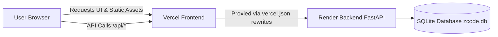

# 🚀 Z-Code 1.0 — Production Deployment Guide

This guide walks you through deploying **Z-Code 1.0** to production using the optimal modern stack:
- **Frontend** ➔ **Vercel** (Global edge CDN, instant page loads, HTTPS)
- **Backend & Database** ➔ **Render** (Continuous Python runtime, persistent SQLite database via `render.yaml`)

---

## 🏗️ Architecture Overview



- **Zero CORS issues**: Vercel acts as a reverse proxy for `/api/*` directly to your Render backend.
- **Persistent Data**: User signups, quiz completions, streaks, and XP are stored safely in SQLite on Render without serverless data wipes.
- **Local Dev Untouched**: When running on `localhost`, the frontend automatically calls `http://localhost:8000/api`.

---

## 📋 Step 1: Push Changes to GitHub

Ensure your latest code with the Vercel and Render configuration is committed and pushed to GitHub:

```bash
git add .
git commit -m "feat: add Vercel and Render production deployment configuration"
git push origin main
```

---

## 🐍 Step 2: Deploy Backend on Render

1. Go to [Render.com](https://dashboard.render.com/) and sign in.
2. Click **New +** and select **Blueprint**.
3. Connect your GitHub repository (`Z-code-1.0`).
4. Render will automatically detect [`render.yaml`](file:///Users/dhanushbk/Desktop/Zcode/Z-code-1.0/render.yaml) and configure the `zcode-backend` web service:
   - **Environment**: Python
   - **Build Command**: `bash backend/setup.sh`
   - **Start Command**: `bash backend/start.sh`
   - **Health Check**: `/api/health`
5. Click **Apply**. Render will build and deploy your FastAPI backend.
6. Once deployed, copy your Render Web Service URL (e.g., `https://zcode-backend-xxxx.onrender.com`).

> **Tip**: Test your backend by visiting `https://your-backend.onrender.com/api/health` in your browser. It should return `{"status":"ok","version":"1.0.0","platform":"Z-Code"}`.

---

## ⚡ Step 3: Deploy Frontend on Vercel

### Option A: Via Vercel Web Dashboard (Recommended)

1. Go to [Vercel.com](https://vercel.com/) and sign in with GitHub.
2. Click **Add New…** ➔ **Project**.
3. Select your `Z-code-1.0` GitHub repository and click **Import**.
4. In the Project Configuration screen:
   - **Framework Preset**: *Other*
   - **Root Directory**: `./` (leave default, our root [`vercel.json`](file:///Users/dhanushbk/Desktop/Zcode/Z-code-1.0/vercel.json) handles routing)
     *(Alternatively, you can choose `Z-Code-Frontend-Starter` as Root Directory; both work out-of-the-box!)*
5. Click **Deploy**.
6. In a few seconds, your site is live at `https://your-project.vercel.app`!

### Option B: Via Vercel CLI (Terminal)

Run this command from your project root:

```bash
npx vercel
```

Follow the prompts (accept defaults). For production deployment:
```bash
npx vercel --prod
```

---

## 🔗 Step 4: Connect Vercel Frontend to Render Backend

In [`vercel.json`](file:///Users/dhanushbk/Desktop/Zcode/Z-code-1.0/vercel.json), replace `https://zcode-backend.onrender.com` with your actual Render URL:

```json
{
  "rewrites": [
    {
      "source": "/api/:path*",
      "destination": "https://YOUR-ACTUAL-RENDER-URL.onrender.com/api/:path*"
    }
  ]
}
```

Commit and push to GitHub, or run `npx vercel --prod`.

### Dynamic In-App Configuration (Alternative)
You can also set or change the backend URL directly from the frontend anytime:
- Open your browser Developer Console (`F12`) on your Vercel site:
  ```javascript
  ZCodeAPI.setBaseUrl("https://YOUR-ACTUAL-RENDER-URL.onrender.com/api");
  ```
- Or verify active backend host in the **Dashboard Settings Modal** (`Account Settings`).

---

## ✅ Step 5: Verification Checklist

1. **Auto-redirect**: Visit your Vercel URL (`https://your-project.vercel.app/`). You should be routed to the Login page.
2. **Demo Login**: Sign in with:
   - Email: `dhanush@zcode.dev`
   - Password: `demo123`
3. **Interactive Features**:
   - Check that user XP, streak, and level are loaded from the backend.
   - Complete a Python lesson or quiz in `python.html` and verify XP updates.
   - Open the AI Tutor chat widget and test conversation responses.
